# Карта импортов и межмодульных зависимостей

**Область:** основные модули AutoDraw_Stage20 и точки входа.  
**Источник:** реальные import/from-import statements, экспортные списки адаптеров и код настройки путей в текущей ветке.  
**Граница:** схема показывает прямые зависимости и уровни импорта. Она не является runtime trace и не утверждает, что каждый импортируемый модуль загружается при каждом пользовательском сценарии.

## 1. Точки входа

| Файл | Роль |
|---|---|
| `integrated_app.py` | Основная точка входа единого приложения Stage20 |
| `source/executor/stage1_calibration.py` | Отдельный legacy-интерфейс калибровки |
| `source/executor/stage2_drawing.py` | Отдельный legacy-интерфейс построения/исполнения |
| `source/executor/stage3_image_processing.py` | Отдельный legacy-интерфейс обработки |
| `source/executor/stage4_contour_planning.py` | Отдельный legacy-интерфейс контурного планирования |
| `source/executor/stage5_stroke_optimization.py` | Отдельный legacy-интерфейс оптимизации |
| `source/executor/stage6_execute_plan.py` | UI executor, встраиваемый в единое приложение |
| `source/game_monitor/game_monitor.js` | Независимый DevTools-snippet для браузера |

В интегрированном приложении `ensure_import_paths()` добавляет каталоги `source/preparation` и `source/executor` в `sys.path`. `configure_environment()` задаёт общие `AUTODRAW_*` пути до импорта компонентов, читающих пути при загрузке.

## 2. Слои зависимостей

### 2.1. Интеграционный слой

`integrated_app.py` непосредственно импортирует:

- Workbench и функции подготовки: `stage13_workbench`, `stage8_optimizer`;
- общую модель плана: `models.DrawingPlan`;
- исполнитель и селекторы: `stage6_execute_plan.Stage6App`, `AreaSelector`, `TargetArea`;
- UI палитры и цветного плана: `palette_detection_ui`, `palette_quantization_ui`, `color_scanline_ui`;
- сериализаторы планов: `color_scanline`, `geometry_color_plan`;
- экспериментальные вкладки: `paint_limit_test_ui`, `brush_behavior_test_ui`, `brush_calibration_ui`.

Интеграционный слой создаёт UI-компоненты, передаёт им callbacks и маршрутизирует планы/профили в Stage6. Подробные связи описаны в [UI_INTEGRATION_MAP.md](UI_INTEGRATION_MAP.md).

### 2.2. Preparation

Основные прямые зависимости UI и модулей подготовки:

| Потребитель | Импортируемые модули |
|---|---|
| `stage13_workbench` | `image_processing`, `stage8_optimizer`, `stage9_quality`, `autodraw_project`, `profile_manager` |
| `palette_detection_ui` | `palette_detection`, `palette_reduction`, `palette_profiles` |
| `palette_quantization_ui` | `palette_profiles`, `palette_quantization` |
| `color_scanline_ui` | `paint_cost_model`, `brush_planner`, `board_resource_model`, `paint_budget_optimizer`, `color_scanline`, `geometry_color_plan` |
| `paint_limit_test_ui` | `color_scanline`, `paint_limit_test`, `palette_profiles` |
| `brush_behavior_test_ui` | `stage8_optimizer`, `brush_test_workflow`, `brush_experiment_capture` |
| `brush_calibration_ui` | `brush_calibration` |

Дополнительные прямые зависимости модулей подготовки описаны по каждому модулю в [PREPARATION_API_REFERENCE.md](PREPARATION_API_REFERENCE.md); этот документ не перечисляет все транзитивные связи библиотек.

### 2.3. Executor

| Потребитель | Импортируемые модули |
|---|---|
| `stage6_execute_plan` | `drawing.mouse_executor`, `drawing.color_plan_execution`, `brush_planner`, `drawing.execution_diagnostics`, `drawing.plan_transform`, `models`, `color_scanline`, `geometry_color_plan`, `paint_cost_model`, `palette_profiles`, `path_planning.stroke_optimizer` |
| `drawing.mouse_executor` | `models`, PyAutoGUI, pynput keyboard |
| `drawing.color_plan_execution` | `models`; по требованию — `palette_profiles`, `color_scanline`, `geometry_color_plan`, `brush_planner` |
| `drawing.plan_transform` | `models` |
| `drawing.execution_diagnostics` | стандартная библиотека Python |
| `path_planning.contour_planner` | `models`, OpenCV, NumPy, Pillow |
| `path_planning.stroke_optimizer` | `models`, OpenCV, NumPy |

### 2.4. Общие модули и compatibility adapters

- `geometry_models/` содержит общие определения `Point`, `Stroke`, `DrawingPlan`.
- Локальный `models` import в preparation/executor используется как compatibility-слой к общим геометрическим классам.
- `shared_image_processing/pipeline.py` — общий конвейер обработки изображения.
- `source/preparation/image_processing/pipeline.py` и `source/executor/image_processing/pipeline.py` — совместимые адаптеры, реэкспортирующие определения общего конвейера.
- Оба адаптера экспортируют `FitMode`, `ThresholdMode`, `ProcessingResult`, `ProcessingSettings`, `fit_to_canvas`, `load_rgb_image`, `process_image` через `__all__`.

## 3. Диаграмма основных зависимостей

```mermaid
flowchart TD
    IA[integrated_app.py]
    IA --> W[stage13_workbench]
    IA --> S6[stage6_execute_plan]
    IA --> PD[palette_detection_ui]
    IA --> PQ[palette_quantization_ui]
    IA --> CS[color_scanline_ui]
    IA --> PL[paint_limit_test_ui]
    IA --> BT[brush_behavior_test_ui]
    IA --> BC[brush_calibration_ui]

    W --> IP[shared image processing]
    W --> PFM[profile_manager]
    W --> PRJ[autodraw_project]
    PQ --> PP[palette_profiles]
    PQ --> Q[palette_quantization]
    PD --> DET[palette_detection]
    PD --> RED[palette_reduction]
    CS --> CSP[color_scanline]
    CS --> GEO[geometry_color_plan]
    CS --> COST[paint_cost_model]
    CS --> BPL[brush_planner]
    PL --> PLM[paint_limit_test]
    BT --> BWF[brush_test_workflow]
    BT --> BEC[brush_experiment_capture]

    S6 --> ME[MouseExecutor]
    S6 --> CPE[color_plan_execution]
    S6 --> TR[plan_transform]
    S6 --> DIAG[execution_diagnostics]
    S6 --> OPT[stroke_optimizer]
    S6 --> MODELS[models compatibility adapter]
    CPE --> PP
    CPE --> CSP
    CPE --> GEO
    CPE --> BPL
    ME --> MODELS
    OPT --> MODELS
```

## 4. Импортные соглашения и ограничения

- Пути импорта preparation/executor зависят от того, что интегрированное приложение добавляет оба каталога исходников в `sys.path`.
- Общие модули импортируются через compatibility-имена; физический файл-адаптер и исходное определение класса могут находиться в разных каталогах.
- Не следует считать каждый импорт прямым пользовательским API: часть импортов локальная и используется только внутри одного модуля.
- `__all__` явно подтверждён для двух image-processing adapters; другие модули в этой карте не объявляются пакетными публичными API без соответствующего списка в исходнике.
- Game Monitor не импортируется Python-приложением: это отдельный JavaScript-файл, вставляемый в DevTools браузера.
- Тестовые модули рассматриваются как отдельные потребители production-кода и не включены в диаграмму основного приложения.

## 5. Источники для детализации

- [MODULE_REFERENCE.md](MODULE_REFERENCE.md) — каталог модулей.
- [PREPARATION_API_REFERENCE.md](PREPARATION_API_REFERENCE.md) — API preparation.
- [EXECUTOR_API_REFERENCE.md](EXECUTOR_API_REFERENCE.md) — API executor.
- [UI_INTEGRATION_MAP.md](UI_INTEGRATION_MAP.md) — callback-связи и передача данных.
- [CONFIGURATION_AND_DATA.md](CONFIGURATION_AND_DATA.md) — каталоги и переменные окружения.

## 6. Полная инвентаризация прямых внутрипроектных импортов

В таблицах перечислены только импорты других модулей AutoDraw. Стандартная библиотека Python и внешние библиотеки (Tkinter, Pillow, NumPy, OpenCV, PyAutoGUI, pynput и др.) намеренно опущены. Это карта прямых импортов, а не транзитивное замыкание.

### 6.1. Preparation — 40 модулей

| Модуль | Прямые импорты AutoDraw |
|---|---|
| `autodraw_project.py` | `stage9_quality` |
| `stage13_workbench.py` | `image_processing`, `stage8_optimizer`, `stage9_quality`, `autodraw_project`, `profile_manager` |
| `stage8_optimizer.py` | — |
| `stage9_quality.py` | — |
| `profile_manager.py` | — |
| `palette_profiles.py` | `palette_detection` |
| `image_processing/pipeline.py` | `shared_image_processing.pipeline` |
| `layer_segmentation.py` | — |
| `multi_board_splitter.py` | — |
| `palette_detection.py` | — |
| `palette_quantization.py` | — |
| `palette_reduction.py` | `palette_detection` |
| `color_scanline.py` | `palette_quantization`, `board_resource_model`, `paint_cost_model`, `engine_point_calibration` |
| `geometry_color_plan.py` | `palette_quantization`, `paint_cost_model`, `layer_segmentation`, `skeletonization`, `stroke_simplification`, `stroke_order_optimizer`, `geometry_budget_optimizer`, `multi_board_splitter` |
| `palette_detection_ui.py` | `palette_detection`, `palette_reduction`, `palette_profiles` |
| `palette_quantization_ui.py` | `palette_profiles`, `palette_quantization` |
| `color_scanline_ui.py` | `paint_cost_model`, `brush_planner`, `board_resource_model`, `paint_budget_optimizer`, `color_scanline`, `geometry_color_plan` |
| `skeletonization.py` | — |
| `stroke_simplification.py` | — |
| `stroke_order_optimizer.py` | — |
| `interior_fill_planner.py` | `brush_footprint_geometry` |
| `outline_first_fill_planner.py` | `brush_footprint_geometry`, `interior_fill_planner` |
| `swept_footprint_geometry.py` | `brush_footprint_geometry` |
| `geometry_budget_optimizer.py` | — |
| `brush_footprint_geometry.py` | — |
| `brush_planner.py` | `brush_footprint_geometry` |
| `brush_calibration.py` | — |
| `brush_experiment_capture.py` | — |
| `brush_test_workflow.py` | — |
| `board_resource_model.py` | — |
| `paint_cost_model.py` | — |
| `paint_budget_optimizer.py` | `color_scanline`, `board_resource_model`, `engine_point_calibration`, `paint_cost_model`, `palette_quantization` |
| `paint_limit_test.py` | `color_scanline`, `palette_profiles`, `palette_quantization` |
| `game_point_calibration.py` | `board_resource_model`, `engine_point_calibration`, `interval_quota_fit` |
| `engine_point_calibration.py` | `board_resource_model`, `paint_cost_model` |
| `interval_quota_fit.py` | — |
| `drawing_algorithm_benchmark.py` | `palette_quantization`, `board_resource_model`, `engine_point_calibration`, `paint_cost_model` |
| `brush_behavior_test_ui.py` | `stage8_optimizer`, `brush_test_workflow`, `brush_experiment_capture` |
| `brush_calibration_ui.py` | `brush_calibration` |
| `paint_limit_test_ui.py` | `color_scanline`, `paint_limit_test`, `palette_profiles` |

### 6.2. Executor — 13 модулей

| Модуль | Прямые импорты AutoDraw |
|---|---|
| `stage1_calibration.py` | — |
| `stage2_drawing.py` | `drawing.mouse_executor`, `models`, `path_planning.test_shape` |
| `stage3_image_processing.py` | — |
| `stage4_contour_planning.py` | `models`, `path_planning.contour_planner` |
| `stage5_stroke_optimization.py` | `models`, `path_planning.stroke_optimizer` |
| `stage6_execute_plan.py` | `drawing.mouse_executor`, `drawing.color_plan_execution`, `brush_planner`, `drawing.execution_diagnostics`, `drawing.plan_transform`, `models`, `color_scanline`, `geometry_color_plan`, `paint_cost_model`, `palette_profiles`, `path_planning.stroke_optimizer` |
| `drawing/mouse_executor.py` | `models` |
| `drawing/color_plan_execution.py` | `models` |
| `drawing/plan_transform.py` | `models` |
| `drawing/execution_diagnostics.py` | — |
| `path_planning/contour_planner.py` | `models` |
| `path_planning/stroke_optimizer.py` | `models` |
| `path_planning/test_shape.py` | `models` |

### 6.3. Общие модели и адаптеры

- `geometry_models/__init__.py` экспортирует канонические `Point`, `Stroke`, `DrawingPlan`.
- `source/preparation/models/` и `source/executor/models/` — совместимые пакеты. Их `__init__.py` и отдельные модули переэкспортируют классы из `geometry_models`.
- `shared_image_processing/pipeline.py` — единое определение общего image-processing API.
- `source/preparation/image_processing/pipeline.py` и `source/executor/image_processing/pipeline.py` — адаптеры с одинаковым `__all__`: `FitMode`, `ThresholdMode`, `ProcessingResult`, `ProcessingSettings`, `fit_to_canvas`, `load_rgb_image`, `process_image`.
- Импортные пути `models`, `image_processing`, `stage8_optimizer` и другие короткие имена работают в контексте настроенного `sys.path`; их нельзя автоматически трактовать как абсолютные пакеты верхнего уровня.

### 6.4. Границы инвентаризации

- В таблицах отражены импорты 40 модулей preparation и 13 модулей executor из MODULE_REFERENCE.
- `integrated_app.py` описан отдельно в разделе 2.1 как интеграционный потребитель.
- Game Monitor остаётся отдельной JavaScript-подсистемой; Python smoke server не импортируется в основной UI.
- Вспомогательные тесты и скрипты из `tests/`, `source/preparation/tests/` и `source/executor/tests/` не включены в эту матрицу. Они образуют следующий отдельный слой зависимостей и не должны смешиваться с импортами production-модулей.
