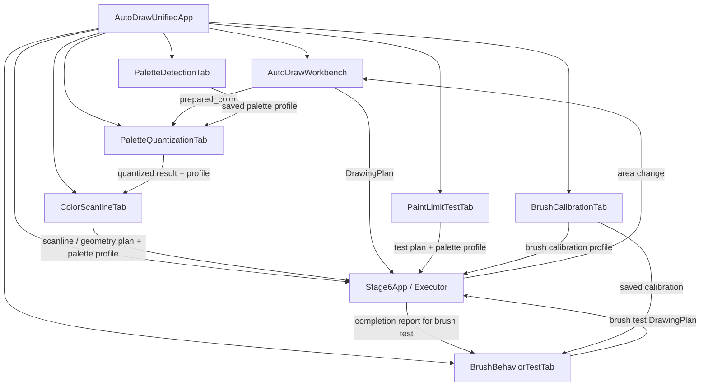

# Карта UI и интеграционных точек AutoDraw

**Точка сборки приложения:** `AutoDraw_Stage20/integrated_app.py`.  
**Область:** соединение UI подсистем preparation и executor в едином Tkinter-приложении.  
**Источник:** конструкторы, callback-параметры и места подключения текущей ветки.  
**Граница:** документ описывает wiring и передачу данных между компонентами, но не оценивает поведение интерфейса и не запускает приложение.

## 1. Точка сборки

`AutoDrawUnifiedApp` создаёт единое окно и восемь вкладок:

| № | Вкладка | UI-компонент |
|---|---|---|
| 1 | Подготовка изображения | `AutoDrawWorkbench` |
| 2 | Исполнение рисунка | `Stage6App` |
| 3 | Палитра браузера | `PaletteDetectionTab` |
| 4 | Преобразование в палитру | `PaletteQuantizationTab` |
| 5 | Цветной scanline-план | `ColorScanlineTab` |
| 6 | Тест лимита краски | `PaintLimitTestTab` |
| 7 | Тест кистей | `BrushBehaviorTestTab` |
| 8 | Калибровка теста | `BrushCalibrationTab` |

Импорты выполняются после `ensure_import_paths()` и `configure_environment()`: приложение добавляет каталоги preparation/executor в `sys.path` и задаёт общие пути данных до импорта модулей, которые читают настройки при загрузке.

## 2. Карта создания компонентов

| Компонент | Родительский контейнер | Внешние зависимости |
|---|---|---|
| `AutoDrawWorkbench` | Прокручиваемая область вкладки 1 | `on_select_canvas_area` |
| `Stage6App` | Вкладка 2 | После создания назначается `area_change_callback` и `execution_finished_callback` |
| `PaletteDetectionTab` | Прокручиваемая область вкладки 3 | Каталог палитр |
| `PaletteQuantizationTab` | Вкладка 4 | Каталог профилей палитр, каталог результатов, `get_prepared_image` |
| `ColorScanlineTab` | Прокручиваемая область вкладки 5 | Каталог цветных планов, `get_quantized_data` |
| `PaintLimitTestTab` | Вкладка 6 | Каталоги результатов и профилей, `get_canvas_size`, `on_transfer_plan` |
| `BrushCalibrationTab` | Вкладка 8 | Путь JSON калибровки, `on_profile_saved` |
| `BrushBehaviorTestTab` | Вкладка 7 | `AreaSelector`, callbacks размера/области/калибровки/передачи плана/старта исполнителя |

Прокрутка включена для вкладок 1, 3 и 5 через `ScrollableTabContent`; другие компоненты управляют собственными областями прокрутки либо размещаются напрямую в родительской вкладке.

## 3. Внешние callback-контракты

### 3.1. Подготовка и выбор области

- `AutoDrawWorkbench.on_select_canvas_area` → `AutoDrawUnifiedApp._select_target_area_for_preparation()`.
- Callback вызывает штатный выбор области executor через `Stage6App._select_area()`.
- `Stage6App.area_change_callback` → `_synchronize_area_with_preparation(area, screen_size)`.
- Синхронизация передаёт область в `AutoDrawWorkbench.set_target_area()`, размер холста — в `PaletteQuantizationTab.set_target_canvas_size()`, а текущий источник цветного плана инвалидируется через `ColorScanlineTab.invalidate_source()`.

### 3.2. Подготовленное изображение и квантованные данные

- `PaletteQuantizationTab.get_prepared_image` → `_get_prepared_color_image()`.
- Callback возвращает копию `workbench.result.prepared_color`, если результат и изображение доступны.
- `ColorScanlineTab.get_quantized_data` → `_get_quantized_data()`.
- Callback формирует документ-обёртку с `result`, `profile`, `report`, `source_name` на основе текущего результата вкладки 4.

### 3.3. Тест лимита краски

- `PaintLimitTestTab.get_canvas_size` → `_get_execution_canvas_size()`.
- `PaintLimitTestTab.on_transfer_plan` → `_transfer_paint_limit_plan(plan, palette_profile, source_path)`.
- При передаче план записывается в каталог результатов теста, профиль палитры загружается в executor, затем цветной план передаётся через `load_color_plan_from_path()`.

### 3.4. Калибровка и тест кисти

- `BrushCalibrationTab.on_profile_saved` → `_on_brush_calibration_saved(profile)`.
- Сохранённый профиль кисти передаётся в executor через `apply_brush_control_profile()`; вкладка теста кистей обновляет свои поля калибровки.
- `BrushBehaviorTestTab.get_canvas_size` → `_get_brush_test_canvas_size()`.
- `BrushBehaviorTestTab.get_canvas_area` → `_get_brush_test_canvas_area()`.
- `BrushBehaviorTestTab.get_brush_control` → `_get_brush_test_brush_control()`.
- `BrushBehaviorTestTab.get_calibration_profile` → `_get_brush_test_calibration_profile()`.
- `BrushBehaviorTestTab.on_transfer_plan` → `_transfer_brush_test_plan(plan, source_path)`.
- `BrushBehaviorTestTab.on_brush_ready` → `_start_brush_test_executor(requested_brush)`.
- `Stage6App.execution_finished_callback` → `_on_executor_finished(summary, report_path)`; callback передаёт завершение в brush-test UI только для специального плана теста кисти.

## 4. Передача планов в executor

### 4.1. Одноцветный DrawingPlan

Источник: `AutoDrawWorkbench.plan`.

1. `_transfer_plan_to_executor()` получает план Workbench.
2. `write_validated_execution_plan()` записывает временный JSON, загружает его через `DrawingPlan.load()`, вызывает `validate_bounds()` и публикует целевой файл.
3. Используется runtime-файл `current_plan_for_execution.json`.
4. Executor получает путь через `load_plan_from_path()`.

### 4.2. Цветной план

Источник: `ColorScanlineTab.plan` и `ColorScanlineTab.palette_profile`.

1. `_transfer_color_plan_to_executor()` проверяет тип цветного плана и наличие связанного профиля палитры.
2. Для `autodraw_color_scanline_plan` используется `save_color_scanline_plan()` и файл `current_color_plan_for_execution.json`.
3. Для `autodraw_geometry_color_plan` используется `save_geometry_color_plan()` и файл `current_geometry_color_plan_for_execution.json`.
4. Профиль палитры передаётся через `load_color_palette_profile_document()`.
5. План передаётся через `load_color_plan_from_path()`.

### 4.3. Brush behavior test

Источник: `BrushBehaviorTestTab`.

- План сохраняется во временный runtime-файл `current_brush_behavior_test.json` после проверки совместимости с `DrawingPlan`.
- Если в профиле калибровки задана область доски, приложение получает её через `BrushCalibrationTab.get_board_area()` и передаёт в executor как `TargetArea`.
- Перед запуском вызывается `start_execution_from_workflow()` после подтверждения выбранного пользователем радиуса.
- Завершение исполнения маршрутизируется в `BrushBehaviorTestTab.handle_executor_finished()`.

### 4.4. Paint-limit test

- План сохраняется в каталоге `paint_limit_tests` под именем `current_paint_limit_plan_<scenario>.json`.
- Профиль палитры загружается в executor отдельно от файла плана.
- Цветной план передаётся штатным методом `load_color_plan_from_path()`.

## 5. Схема связей

## 6. Передаваемые данные и файлы

| Источник | Получатель | Данные/файл |
|---|---|---|
| Workbench | Executor | `current_plan_for_execution.json` |
| ColorScanlineTab | Executor | `current_color_plan_for_execution.json` или `current_geometry_color_plan_for_execution.json` |
| BrushBehaviorTestTab | Executor | `current_brush_behavior_test.json` |
| PaintLimitTestTab | Executor | `current_paint_limit_plan_<scenario>.json` |
| BrushCalibrationTab | Executor и BrushBehaviorTestTab | JSON-профиль калибровки и callback-словарь brush control |
| Executor | Workbench / Quantizer / ColorScanlineTab | Область экрана и её размеры |
| Executor | BrushBehaviorTestTab | Сводка исполнения и путь к отчёту |

Каталоги и переменные окружения подробно описаны в [CONFIGURATION_AND_DATA.md](CONFIGURATION_AND_DATA.md). Схемы JSON-профилей и планов описаны в [DATA_FORMATS_AND_PROFILES.md](DATA_FORMATS_AND_PROFILES.md).

## 7. Пути данных и конфигурация

`configure_environment()` формирует общие пути:

- `data/profiles/`;
- `data/palettes/`;
- `data/projects/`;
- `data/results/`;
- `data/logs/`;
- `data/runtime/`;
- `data/results/palette_conversions/`;
- `data/results/color_scanline_plans/`;
- `data/results/paint_limit_tests/`;
- `data/results/brush_behavior_tests/`;
- `data/profiles/brush_paint_calibration.json`.

Функция также задаёт `AUTODRAW_*` переменные окружения, используемые импортируемыми компонентами. При документировании путей учитывать, что `brush_calibration` в `DATA_PATHS` — файл JSON, а остальные перечисленные значения — каталоги.

## 8. Границы интеграционной карты

- Перечислены внешние зависимости, явно переданные через конструкторы или назначенные после создания компонентов.
- Внутренние обработчики Tkinter и методы, вызываемые только внутри одного компонента, не трактуются как внешние API.
- Вызовы приватных методов executor в интеграционном слое указаны как фактические точки соединения, а не как публичная гарантия совместимости.
- Эта карта не описывает алгоритмы обработки изображений, исполнения мыши или внутреннюю работу браузерной игры.

## Дополнение 2026-10-31 — Brush Test logical→screen handoff

Вкладка Brush Test получает от integrated_app логический размер 460×240 и отдельно экранную область ROI. При callback передачи плана integrated_app проверяет coordinate_system: logical_board_pixels проходит через brush_coordinate_transform и превращается в local_canvas_pixels под размеры ROI; обычный local_canvas_pixels должен уже совпадать с ROI и остаётся без трансформации. В Stage6 загружается только runtime screen-local копия. Исходный logical-план и параметры transform сохраняются в файле эксперимента.
