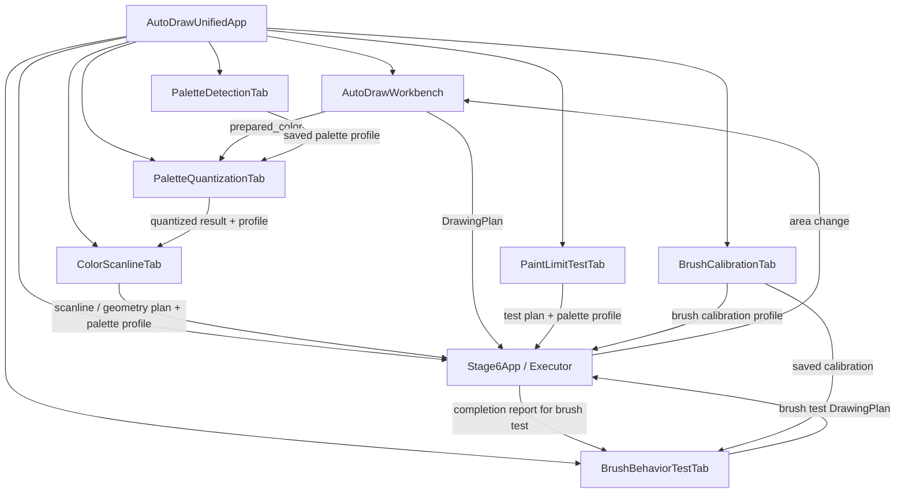

# Карта UI и интеграционных точек AutoDraw

## FILL-001 — экспериментальное подключение Firefox Selenium (2026-11-10)

> **Исторический снимок (2026-11-10).** Утверждения ниже о не подключённом Stage6 и отдельном V5 не являются текущим статусом. В нынешнем коде серия использует общий Selenium Firefox/Bridge worker и Stage6 через `source/preparation/chalk_fill_ui.py`, `fill001_series_runner.py`, `fill001_series_stage6_execution.py`, `fill001_series_engine001_clear.py`; фактические gates и неустранённые E4 см. [PROJECT_STATUS.md](PROJECT_STATUS.md) и [TASKS.md](TASKS.md). Исправление Selenium isolation — `0e5075b`, новая quota-limited ветка — `6eae2c9`. Описания API сверять по текущему SHA.

Во вкладке `Fill001Tab` появились три дополнительные команды: «Firefox: открыть игру + Bridge автоматически», «Подтвердить: доска открыта», «Остановить Firefox-сессию». Они используют существующий `BrushBehaviorTestTab.start_game_monitor_bridge(require_input_telemetry=True, origin_override="https://eufbpet.hust.me/")`, новую вспомогательную функцию `firefox_monitor_session.attach_monitor_after_confirmation` и **не** запускают `Stage6App` самостоятельно. WebDriver открывает портал `https://pet-eu.hust.me/`, проверяет Origin Egret iframe и использует уже поставляемые `game_monitor.js` и одноразовый Bridge snippet. Успешное внедрение не равняется подтверждённому Bridge connection — проверяется новая отдельная сессия и Input Telemetry ON.

Оператор подтверждает только видимую игровую доску, но это **не** замена существующим проверкам ROI, desktop coordinate mapping, brush radius, Clear или правилу одного FILL-001 task. В случае BLOCKED Firefox остаётся открытым для диагностики до явной остановки. Mixed-width DEC-030 V5 ещё не маршрутизирован в Stage6; альтернативный one-click runner не включён в production UI.

**Точка сборки приложения:** `AutoDraw_Stage20/integrated_app.py`.  
**Область:** соединение UI подсистем preparation и executor в едином Tkinter-приложении.  
**Источник:** конструкторы, callback-параметры и места подключения текущей ветки.  
**Граница:** документ описывает wiring и передачу данных между компонентами, но не оценивает поведение интерфейса и не запускает приложение.

## 1. Точка сборки

`AutoDrawUnifiedApp` создаёт единое окно и девять вкладок:

| № | Вкладка | UI-компонент |
|---|---|---|
| 1 | Подготовка изображения | `AutoDrawWorkbench` |
| 2 | Исполнение рисунка | `Stage6App` |
| 3 | Палитра браузера | `PaletteDetectionTab` |
| 4 | Преобразование в палитру | `PaletteQuantizationTab` |
| 5 | Цветной scanline-план | `ColorScanlineTab` |
| 6 | Тест лимита краски | `PaintLimitTestTab` |
| 7 | Тест кистей | `BrushBehaviorTestTab` |
| 8 | FILL-001 | `Fill001Tab` |
| 9 | Калибровка теста | `BrushCalibrationTab` |

Импорты выполняются после `ensure_import_paths()` и `configure_environment()`: приложение добавляет каталоги preparation/executor в `sys.path` и задаёт общие пути данных до импорта модулей, которые читают настройки при загрузке.

## 2. Карта создания компонентов

| Компонент | Родительский контейнер | Внешние зависимости |
|---|---|---|
| `AutoDrawWorkbench` | Прокручиваемая область вкладки 1 | `on_select_canvas_area` |
| `Stage6App` | Вкладка 2 | После создания назначается `area_change_callback` и `execution_finished_callback` |
| `PaletteDetectionTab` | Прокручиваемая область вкладки 3 | Каталог палитр |
| `PaletteQuantizationTab` | Вкладка 4 | Каталог профилей палитр, каталог результатов, `get_prepared_image` |
| `ColorScanlineTab` | Прокручиваемая область вкладки 5 | Каталог цветных планов, `get_quantized_data` |
| `PaintLimitTestTab` | Вкладка 6 | Каталоги результатов и профилей, `get_canvas_size`, `on_transfer_plan` |
| `Fill001Tab` | Вкладка 8 | FILL-001 manifest, single-task planner handoff, operator approval и capture finalization |
| `BrushCalibrationTab` | Вкладка 9 | Путь JSON калибровки, `on_profile_saved` |
| `BrushBehaviorTestTab` | Вкладка 7 | `AreaSelector`, callbacks размера/области/калибровки/передачи плана/старта исполнителя |

Прокрутка включена для вкладок 1, 3 и 5 через `ScrollableTabContent`; другие компоненты управляют собственными областями прокрутки либо размещаются напрямую в родительской вкладке.

## 3. Внешние callback-контракты

### 3.1. Подготовка и выбор области

- `AutoDrawWorkbench.on_select_canvas_area` → `AutoDrawUnifiedApp._select_target_area_for_preparation()`.
- Callback вызывает штатный выбор области executor через `Stage6App._select_area()`.
- `Stage6App.area_change_callback` → `_synchronize_area_with_preparation(area, screen_size)`.
- Синхронизация передаёт область в `AutoDrawWorkbench.set_target_area()`, размер холста — в `PaletteQuantizationTab.set_target_canvas_size()`, а текущий источник цветного плана инвалидируется через `ColorScanlineTab.invalidate_source()`.

### 3.2. Подготовленное изображение и квантованные данные

- `PaletteQuantizationTab.get_prepared_image` → `_get_prepared_color_image()`.
- Callback возвращает копию `workbench.result.prepared_color`, если результат и изображение доступны.
- `ColorScanlineTab.get_quantized_data` → `_get_quantized_data()`.
- Callback формирует документ-обёртку с `result`, `profile`, `report`, `source_name` на основе текущего результата вкладки 4.

### 3.3. Тест лимита краски

- `PaintLimitTestTab.get_canvas_size` → `_get_execution_canvas_size()`.
- `PaintLimitTestTab.on_transfer_plan` → `_transfer_paint_limit_plan(plan, palette_profile, source_path)`.
- При передаче план записывается в каталог результатов теста, профиль палитры загружается в executor, затем цветной план передаётся через `load_color_plan_from_path()`.

### 3.4. Калибровка и тест кисти

- `BrushCalibrationTab.on_profile_saved` → `_on_brush_calibration_saved(profile)`.
- Сохранённый профиль кисти передаётся в executor через `apply_brush_control_profile()`; вкладка теста кистей обновляет свои поля калибровки.
- `BrushBehaviorTestTab.get_canvas_size` → `_get_brush_test_canvas_size()`.
- `BrushBehaviorTestTab.get_canvas_area` → `_get_brush_test_canvas_area()`.
- `BrushBehaviorTestTab.get_brush_control` → `_get_brush_test_brush_control()`.
- `BrushBehaviorTestTab.get_calibration_profile` → `_get_brush_test_calibration_profile()`.
- `BrushBehaviorTestTab.on_transfer_plan` → `_transfer_brush_test_plan(plan, source_path)`.
- `BrushBehaviorTestTab.on_brush_ready` → `_start_brush_test_executor(requested_brush)`.
- `Stage6App.execution_finished_callback` → `_on_executor_finished(summary, report_path)`; callback передаёт завершение в brush-test UI только для специального плана теста кисти.

## 4. Передача планов в executor

### 4.1. Одноцветный DrawingPlan

Источник: `AutoDrawWorkbench.plan`.

1. `_transfer_plan_to_executor()` получает план Workbench.
2. `write_validated_execution_plan()` записывает временный JSON, загружает его через `DrawingPlan.load()`, вызывает `validate_bounds()` и публикует целевой файл.
3. Используется runtime-файл `current_plan_for_execution.json`.
4. Executor получает путь через `load_plan_from_path()`.

### 4.2. Цветной план

Источник: `ColorScanlineTab.plan` и `ColorScanlineTab.palette_profile`.

1. `_transfer_color_plan_to_executor()` проверяет тип цветного плана и наличие связанного профиля палитры.
2. Для `autodraw_color_scanline_plan` используется `save_color_scanline_plan()` и файл `current_color_plan_for_execution.json`.
3. Для `autodraw_geometry_color_plan` используется `save_geometry_color_plan()` и файл `current_geometry_color_plan_for_execution.json`.
4. Профиль палитры передаётся через `load_color_palette_profile_document()`.
5. План передаётся через `load_color_plan_from_path()`.

### 4.3. Brush behavior test

Источник: `BrushBehaviorTestTab`.

- План сохраняется во временный runtime-файл `current_brush_behavior_test.json` после проверки совместимости с `DrawingPlan`.
- Если в профиле калибровки задана область доски, приложение получает её через `BrushCalibrationTab.get_board_area()` и передаёт в executor как `TargetArea`.
- Перед запуском вызывается `start_execution_from_workflow()` после подтверждения выбранного пользователем радиуса.
- Завершение исполнения маршрутизируется в `BrushBehaviorTestTab.handle_executor_finished()`.

### 4.4. Paint-limit test

- План сохраняется в каталоге `paint_limit_tests` под именем `current_paint_limit_plan_<scenario>.json`.
- Профиль палитры загружается в executor отдельно от файла плана.
- Цветной план передаётся штатным методом `load_color_plan_from_path()`.

## 5. Схема связей

## 6. Передаваемые данные и файлы

| Источник | Получатель | Данные/файл |
|---|---|---|
| Workbench | Executor | `current_plan_for_execution.json` |
| ColorScanlineTab | Executor | `current_color_plan_for_execution.json` или `current_geometry_color_plan_for_execution.json` |
| BrushBehaviorTestTab | Executor | `current_brush_behavior_test.json` |
| PaintLimitTestTab | Executor | `current_paint_limit_plan_<scenario>.json` |
| BrushCalibrationTab | Executor и BrushBehaviorTestTab | JSON-профиль калибровки и callback-словарь brush control |
| Executor | Workbench / Quantizer / ColorScanlineTab | Область экрана и её размеры |
| Executor | BrushBehaviorTestTab | Сводка исполнения и путь к отчёту |

Каталоги и переменные окружения подробно описаны в [CONFIGURATION_AND_DATA.md](CONFIGURATION_AND_DATA.md). Схемы JSON-профилей и планов описаны в [DATA_FORMATS_AND_PROFILES.md](DATA_FORMATS_AND_PROFILES.md).

## 7. Пути данных и конфигурация

`configure_environment()` формирует общие пути:

- `data/profiles/`;
- `data/palettes/`;
- `data/projects/`;
- `data/results/`;
- `data/logs/`;
- `data/runtime/`;
- `data/results/palette_conversions/`;
- `data/results/color_scanline_plans/`;
- `data/results/paint_limit_tests/`;
- `data/results/brush_behavior_tests/`;
- `data/profiles/brush_paint_calibration.json`.

Функция также задаёт `AUTODRAW_*` переменные окружения, используемые импортируемыми компонентами. При документировании путей учитывать, что `brush_calibration` в `DATA_PATHS` — файл JSON, а остальные перечисленные значения — каталоги.

## 8. Границы интеграционной карты

- Перечислены внешние зависимости, явно переданные через конструкторы или назначенные после создания компонентов.
- Внутренние обработчики Tkinter и методы, вызываемые только внутри одного компонента, не трактуются как внешние API.
- Вызовы приватных методов executor в интеграционном слое указаны как фактические точки соединения, а не как публичная гарантия совместимости.
- Эта карта не описывает алгоритмы обработки изображений, исполнения мыши или внутреннюю работу браузерной игры.

## Дополнение 2026-10-31 — Brush Test logical→screen handoff

Вкладка Brush Test получает от integrated_app логический размер 460×240 и отдельно экранную область ROI. При callback передачи плана integrated_app проверяет coordinate_system: logical_board_pixels проходит через brush_coordinate_transform и превращается в local_canvas_pixels под размеры ROI; обычный local_canvas_pixels должен уже совпадать с ROI и остаётся без трансформации. В Stage6 загружается только runtime screen-local копия. Исходный logical-план и параметры transform сохраняются в файле эксперимента.

## Управление Game Monitor Bridge на вкладке «Тест кистей»

BrushBehaviorTestTab предоставляет три операции для локального тестового подключения:

- start_game_monitor_bridge() запрашивает точный HTTPS Origin, затем запускает source/game_monitor/start_game_monitor_bridge.bat в отдельной консоли Windows;
- copy_game_monitor_source() копирует source/game_monitor/game_monitor.js;
- copy_game_monitor_bridge_snippet() копирует токенизированный snippet, созданный активным bridge server.

Bridge server получает временный путь через --snippet-file и удаляет его после остановки. Для копирования snippet сервер должен быть запущен, а файл — уже создан.

### 4.3.1. G3 CHALK executor parameter matrix

Автоматический CHALK block runner поддерживает G3 только после принятого G2. Каждая задача передаёт `executor_parameters` в `chalk_experiment_matrix` metadata и сохраняет их в runtime plan. Интеграционный слой читает runtime plan при подтверждении кисти, проверяет фиксированный G3 protocol и передаёт полный набор параметров в `Stage6App.start_execution_from_workflow(executor_config_override=...)`.

### 4.3.2. Paired renderer single-stroke test

Вкладка «Тест кистей» содержит отдельный сценарий paired_renderer_single_stroke, не являющийся задачей G1/G2/G3 matrix runner. Он формирует один logical-board stroke и добавляет в generation.paired_renderer_capture версию протокола, requested radius, ожидаемое число strokes, renderer path mode и frozen executor parameters.

AutoDrawUnifiedApp._start_brush_test_executor() читает metadata из runtime plan и fail-closed проверяет профиль, радиус 10 и один stroke; затем передаёт executor override в Stage 6. Override действует только на текущий запуск. Воспроизведение принятых координат выполняется отдельно через tests/game_renderer_reference.html в режиме smooth / line width 10.

Stage6 валидирует override через `ExecutorConfig`, применяет его к текущему запуску и не сохраняет временные значения в пользовательский профиль. Фактическая конфигурация попадает в execution report и сверяется analyzer с metadata.

## Исторический снимок — аудит FILL-001 до UI/runner integration (2026-11-03)

Аудит [CHALK_FILL001_AUTODRAW_INTEGRATION_AUDIT_2026-11-03.md](CHALK_FILL001_AUTODRAW_INTEGRATION_AUDIT_2026-11-03.md) описывает состояние исходников до реализации отдельного UI/runner workflow. Его выводы о полном отсутствии пользовательского пути запуска больше не являются текущим состоянием.

## Актуальная интеграция FILL-001 — 2026-11-03

FILL-001 подключён как отдельная вкладка `8. FILL-001` в `integrated_app.py`; следующая вкладка — `9. Калибровка теста`. Седьмая вкладка «Тест кистей» и её автоматический CHALK block runner не объединяются с FILL-001.

- `source/preparation/chalk_fill_ui.py` реализует `Fill001Tab`: создание/загрузка manifest, выбор одной pending task, отображение frozen metadata и capture finalization.
- Перед передачей task повторно валидируются manifest, plan signature, target mask SHA-256, expected strokes, coverage/leakage и operator approval.
- Размер кисти устанавливается через существующий Brush Test controller; затем создаётся DrawingPlan с FILL-001 experiment context.
- `integrated_app.py` запускает Stage 6 с временным executor override P1: `point_step_px=4`, `point_delay_ms=5`, `line_extension_px=0`. Override относится только к текущему FILL-001 запуску.
- Stage 6 guard блокирует прямой запуск FILL-001 plan в обход специализированного workflow. После исполнения runtime binder связывает executor report с persisted Bridge session/run; UI сохраняет before/after PNG и запускает capture adapter/PNG audit.
- Unified app regression test проверяет регистрацию вкладки и её подпись; полный CI [41673570178](https://github.com/Kiddos19882/AutoDraw/actions/runs/41673570178) подтвердил обязательные test jobs и Windows portable startup smoke-test.

**Logical canvas и client ROI:** BoardPane в движке и frozen FILL-001 masks имеют logical size 460×240. Физический screen ROI клиента определяется калибровкой и не обязан иметь такой размер. UI снимает actual calibrated ROI; adapter растеризует frozen mask в размеры PNG, сохраняет transform и проверяет uniform-scale tolerance 1%. Размер/масштаб игровой доски не подгоняется под AutoDraw.

**Оставшееся ограничение:** CI и synthetic fixtures не заменяют live game session. До одного успешного Windows runtime/PNG preflight нельзя запускать все 45 matrix cells. Требуется проверить фактический P1, Bridge identity/integrity и реальные PNG в client ROI: threshold=8, cursor/UI exclusion, logical mask alignment, coverage ≥99%, leakage=0.

## Дополнение 2026-11-05 — paired renderer scenarios в «Тесте кистей»

В `BrushBehaviorTestTab` добавлены три одноштриховых сценария:

| UI-сценарий | Scenario ID | Логические точки |
|---|---|---|
| Горизонтальный | `paired_renderer_single_stroke` | `(20,120) → (420,120)` |
| Вертикальный | `paired_renderer_vertical_single_stroke` | `(230,20) → (230,220)` |
| Диагональный | `paired_renderer_diagonal_single_stroke` | `(20,20) → (440,220)` |

Все используют радиус 10, smooth renderer и фиксированный executor profile: step=2 px, delay=10 ms, line extension=0. Приложение проверяет scenario metadata, один штрих, радиус, renderer mode и параметры executor перед запуском. Ни один из этих сценариев не меняет production defaults.
